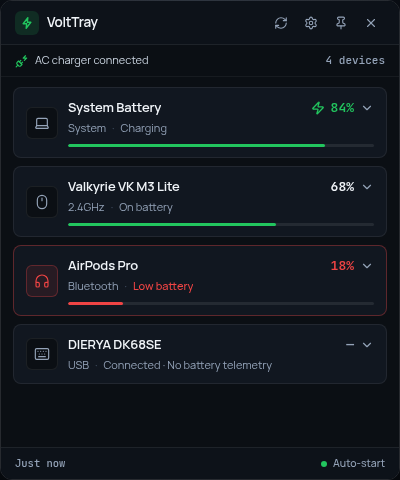

# VoltTray

Local-first, read-only system tray battery monitor for **Windows** and **Linux**, built with **Tauri v2 (Rust)**, **React 19**, **TypeScript**, and **Tailwind CSS v4**.

[Website](https://zero1zx1.github.io/VoltTray_app/) · [Releases](https://github.com/ZERO1zx1/VoltTray_app/releases)

## What VoltTray Does

- **Unified tray popup (400 × 480):** View laptop battery and health where available, Bluetooth headphones including AirPods left/right/case readings via kAirPods, and supported wireless peripherals.
- **Background low-battery alerts:** Hysteresis-guarded native desktop notifications run in the Rust process while the popup is hidden in the system tray.
- **Strictly read-only:** VoltTray does not change DPI, RGB, volume, firmware, Bluetooth pairing, or battery charge limits.
- **Zero telemetry:** The desktop runtime makes no analytics or telemetry calls. It stores only four preferences in the local <code>volttray-state.json</code>: <code>locale</code>, <code>notificationsEnabled</code>, <code>lowBatteryThresholdPct</code>, and <code>launchAtLogin</code>.
- **English and Mongolian:** The UI supports EN and MN.

## Tray Popup Preview

Browser-rendered app preview with sample data. Actual readings depend on the connected hardware and available OS providers.

## Supported Hardware Providers

| Platform | Provider | Devices |
| --- | --- | --- |
| Linux | <code>/sys/class/power_supply</code>, UPower | System battery and supported generic devices |
| Linux | OpenRazer sysfs, HeadsetControl | Supported Razer devices and wireless USB headsets |
| Linux | kAirPods D-Bus, M220 HID | AirPods components; Valkyrie VK M3 Lite over USB or 2.4 GHz |
| Windows | <code>Win32_Battery</code>, WMI, PnP <code>DEVPKEY</code> | System battery/health and supported BLE/HID devices |

See the full [supported-device matrix](docs/supported-devices.md), [AirPods notes](docs/airpods.md), and [M220 setup](docs/m220.md).

## Linux M220 Security Note

For a Valkyrie VK M3 Lite receiver, <code>scripts/install-linux.sh</code> can install the interface-scoped <code>src-tauri/linux/70-volttray-m220.rules</code> rule. It is restricted to USB IDs <code>248a:5d2e</code> / <code>249a:5c2f</code> and interface <code>02</code>. VoltTray does not grant broad hidraw access to keyboards or unrelated input devices.

## CLI Usage

The desktop binary also supports headless commands:

~~~sh
volttray status
volttray status --json
volttray status --low
volttray autostart status
volttray doctor
~~~

See [CLI commands, JSON output, and exit codes](docs/cli.md).

## Install

**Linux (installer from GitHub Releases):**

~~~sh
curl -fsSL https://raw.githubusercontent.com/ZERO1zx1/VoltTray_app/main/scripts/install.sh | bash
~~~

**Windows (PowerShell):**

~~~powershell
irm https://raw.githubusercontent.com/ZERO1zx1/VoltTray_app/main/scripts/install.ps1 | iex
~~~

**Local installer CLI:**

~~~sh
node scripts/cli.mjs doctor --lang mn
node scripts/cli.mjs install --dry-run --lang mn
npm run install:cli -- install --from-source --autostart
~~~

### Windows SmartScreen

Open-source Windows installers may be unsigned and may show a Microsoft SmartScreen reputation prompt. Before running an installer, obtain it from the project release and verify its SHA-256 hash against <code>SHA256SUMS.txt</code>:

~~~powershell
Get-FileHash .\YOUR-INSTALLER.exe -Algorithm SHA256
~~~

Compare the printed hash with the matching filename in the release manifest. On Linux, verify with <code>sha256sum -c SHA256SUMS.txt</code>.

## Development and Build

Requires **Node.js 20.19+ or 22.12+** and the **Rust / Tauri v2** toolchain. CI uses Node.js 22.

~~~sh
npm ci
npm test
npm run typecheck
npm run build
cargo fmt --manifest-path src-tauri/Cargo.toml --all -- --check
cargo clippy --manifest-path src-tauri/Cargo.toml --all-targets -- -D warnings
cargo test --manifest-path src-tauri/Cargo.toml
~~~

To run the browser preview or desktop app:

~~~sh
npm run dev
npm run tauri:dev
npm run tauri:build
~~~

See [CONTRIBUTING.md](CONTRIBUTING.md) and [SECURITY.md](SECURITY.md).

## License

MIT — see [LICENSE](LICENSE).
